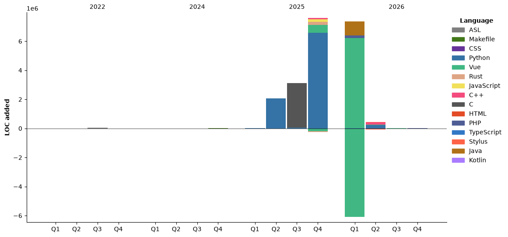

- 👋 Hi, I’m @longzheng268
- 🌏 [https://www.lz-0315.com](https://www.lz-0315.com)
- 📮 admin@lz-0315.com

## GitHub Stats

<div align="center">

  <!-- Snake -->
  <picture>
    <source media="(prefers-color-scheme: dark)" srcset="https://raw.githubusercontent.com/longzheng268/longzheng268/snake-output/github-contribution-grid-snake-dark.svg">
    <source media="(prefers-color-scheme: light)" srcset="https://raw.githubusercontent.com/longzheng268/longzheng268/snake-output/github-contribution-grid-snake.svg">
    
  </picture>

  <br><br>

  <!-- Stats + Top Languages -->
  <picture>
    <source media="(prefers-color-scheme: dark)" srcset="https://raw.githubusercontent.com/longzheng268/longzheng268/stats-output/stats-dark.svg">
    <source media="(prefers-color-scheme: light)" srcset="https://raw.githubusercontent.com/longzheng268/longzheng268/stats-output/stats-light.svg">
    
  </picture>&nbsp;&nbsp;&nbsp;&nbsp;<picture>
    <source media="(prefers-color-scheme: dark)" srcset="https://raw.githubusercontent.com/longzheng268/longzheng268/stats-output/top-langs-dark.svg">
    <source media="(prefers-color-scheme: light)" srcset="https://raw.githubusercontent.com/longzheng268/longzheng268/stats-output/top-langs-light.svg">
    
  </picture>

</div>

## 🔥 GitHub Roast

<div align="center">

[](https://ghfind.com/u/longzheng268?ref=badge)
  <br>
[](https://ghfind.com/u/longzheng268?ref=badge)
</div>

## Wakatime Stats

<!--START_SECTION:waka-->


**🐱 我的 GitHub 数据** 

> 📦  使用了 5.4 MB GitHub 存储空间 
 > 
> 🏆 418 个贡献，在 2026 年
 > 
> 🚫 不开放招聘
 > 
> 📜 82 个公共仓库 
 > 
> 🔑 17 个私人仓库 
 > 
**我是夜猫 🦉** 

```text
🌞 早晨                     158 commits         ⬛⬛⬜⬜⬜⬜⬜⬜⬜⬜⬜⬜⬜⬜⬜⬜⬜⬜⬜⬜⬜⬜⬜⬜⬜   07.19 % 
🌆 白天                     895 commits         ⬛⬛⬛⬛⬛⬛⬛⬛⬛⬛⬜⬜⬜⬜⬜⬜⬜⬜⬜⬜⬜⬜⬜⬜⬜   40.74 % 
🌃 傍晚                     844 commits         ⬛⬛⬛⬛⬛⬛⬛⬛⬛⬛⬜⬜⬜⬜⬜⬜⬜⬜⬜⬜⬜⬜⬜⬜⬜   38.42 % 
🌙 晚上                     300 commits         ⬛⬛⬛⬜⬜⬜⬜⬜⬜⬜⬜⬜⬜⬜⬜⬜⬜⬜⬜⬜⬜⬜⬜⬜⬜   13.65 % 
```
📅 **星期一 时的我最有干劲** 

```text
星期一                      656 commits         ⬛⬛⬛⬛⬛⬛⬛⬜⬜⬜⬜⬜⬜⬜⬜⬜⬜⬜⬜⬜⬜⬜⬜⬜⬜   29.86 % 
星期二                      279 commits         ⬛⬛⬛⬜⬜⬜⬜⬜⬜⬜⬜⬜⬜⬜⬜⬜⬜⬜⬜⬜⬜⬜⬜⬜⬜   12.70 % 
星期三                      167 commits         ⬛⬛⬜⬜⬜⬜⬜⬜⬜⬜⬜⬜⬜⬜⬜⬜⬜⬜⬜⬜⬜⬜⬜⬜⬜   07.60 % 
星期四                      138 commits         ⬛⬛⬜⬜⬜⬜⬜⬜⬜⬜⬜⬜⬜⬜⬜⬜⬜⬜⬜⬜⬜⬜⬜⬜⬜   06.28 % 
星期五                      239 commits         ⬛⬛⬛⬜⬜⬜⬜⬜⬜⬜⬜⬜⬜⬜⬜⬜⬜⬜⬜⬜⬜⬜⬜⬜⬜   10.88 % 
星期六                      156 commits         ⬛⬛⬜⬜⬜⬜⬜⬜⬜⬜⬜⬜⬜⬜⬜⬜⬜⬜⬜⬜⬜⬜⬜⬜⬜   07.10 % 
星期日                      562 commits         ⬛⬛⬛⬛⬛⬛⬜⬜⬜⬜⬜⬜⬜⬜⬜⬜⬜⬜⬜⬜⬜⬜⬜⬜⬜   25.58 % 
```


📊 **本周消耗时间** 

```text
🕑︎ 时区: Asia/Shanghai

💬 编程语言: 
Other                    28 hrs 11 mins      ⬛⬛⬛⬛⬛⬛⬛⬛⬛⬛⬛⬛⬛⬛⬛⬛⬛⬛⬛⬛⬛⬛⬛⬛⬜   96.80 % 
JSON                     55 mins             ⬛⬜⬜⬜⬜⬜⬜⬜⬜⬜⬜⬜⬜⬜⬜⬜⬜⬜⬜⬜⬜⬜⬜⬜⬜   03.20 % 

🔥 编辑器: 
Edge                     28 hrs 54 mins      ⬛⬛⬛⬛⬛⬛⬛⬛⬛⬛⬛⬛⬛⬛⬛⬛⬛⬛⬛⬛⬛⬛⬛⬛⬛   99.25 % 
VS Code                  13 mins             ⬜⬜⬜⬜⬜⬜⬜⬜⬜⬜⬜⬜⬜⬜⬜⬜⬜⬜⬜⬜⬜⬜⬜⬜⬜   00.75 % 

🐱‍💻 项目: 
new-api                  26 hrs 38 mins      ⬛⬛⬛⬛⬛⬛⬛⬛⬛⬛⬛⬛⬛⬛⬛⬛⬛⬛⬛⬛⬛⬛⬛⬜⬜   91.48 % 
wenkong                  2 hrs 15 mins       ⬛⬛⬜⬜⬜⬜⬜⬜⬜⬜⬜⬜⬜⬜⬜⬜⬜⬜⬜⬜⬜⬜⬜⬜⬜   07.74 % 
Unknown Project          13 mins             ⬜⬜⬜⬜⬜⬜⬜⬜⬜⬜⬜⬜⬜⬜⬜⬜⬜⬜⬜⬜⬜⬜⬜⬜⬜   00.75 % 
foobar2000-zh-hans       0 secs              ⬜⬜⬜⬜⬜⬜⬜⬜⬜⬜⬜⬜⬜⬜⬜⬜⬜⬜⬜⬜⬜⬜⬜⬜⬜   00.03 % 

💻 操作系统: 
Windows                  29 hrs 7 mins       ⬛⬛⬛⬛⬛⬛⬛⬛⬛⬛⬛⬛⬛⬛⬛⬛⬛⬛⬛⬛⬛⬛⬛⬛⬛   100.00 % 
```

🤖 **AI Coding This Week** 

```text
No AI Coding Activity Tracked This Week
```

**我最常使用 Python** 

```text
Python                   19 repos            ⬛⬛⬛⬛⬛⬛⬛⬜⬜⬜⬜⬜⬜⬜⬜⬜⬜⬜⬜⬜⬜⬜⬜⬜⬜   27.54 % 
JavaScript               8 repos             ⬛⬛⬛⬜⬜⬜⬜⬜⬜⬜⬜⬜⬜⬜⬜⬜⬜⬜⬜⬜⬜⬜⬜⬜⬜   11.59 % 
Vue                      5 repos             ⬛⬛⬜⬜⬜⬜⬜⬜⬜⬜⬜⬜⬜⬜⬜⬜⬜⬜⬜⬜⬜⬜⬜⬜⬜   07.25 % 
C                        3 repos             ⬛⬜⬜⬜⬜⬜⬜⬜⬜⬜⬜⬜⬜⬜⬜⬜⬜⬜⬜⬜⬜⬜⬜⬜⬜   04.35 % 
EJS                      1 repo              ⬜⬜⬜⬜⬜⬜⬜⬜⬜⬜⬜⬜⬜⬜⬜⬜⬜⬜⬜⬜⬜⬜⬜⬜⬜   01.45 % 
```


**时间线**




 Last Updated on 09-11-2026 07:13:42 UTC
<!--END_SECTION:waka-->
